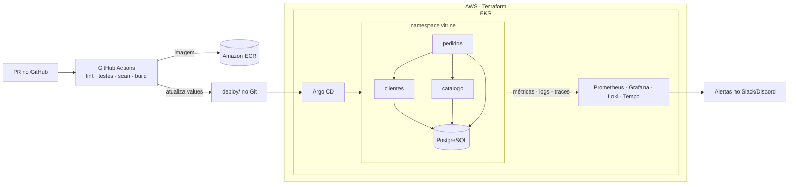
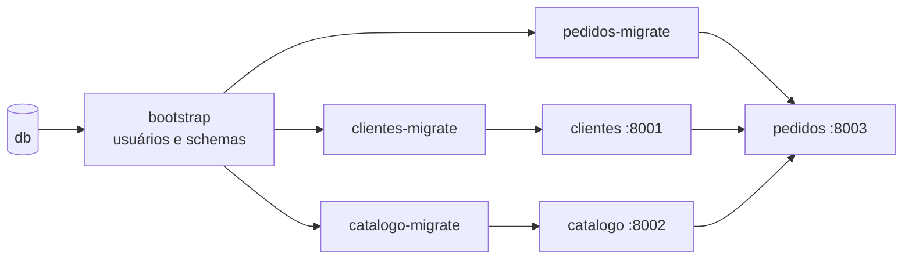

# Vitrine · DevOps portfolio

> 🇧🇷 Mini e-commerce com 3 microsserviços em Kubernetes na AWS, com infraestrutura em Terraform, entrega via GitHub Actions + Argo CD e observabilidade completa (métricas, logs, traces e SLO).
>
> 🇺🇸 A 3-service e-commerce running on Kubernetes (AWS EKS), provisioned with Terraform, delivered through GitHub Actions + Argo CD, and fully observable (metrics, logs, traces, SLOs).

[](https://github.com/devops-navarro/vitrine-devops/actions/workflows/ci.yml)

**Status:** Fase 1 · em construção

## Arquitetura alvo · Target architecture



Detalhes do modelo de dados, do fluxo de pedido e da exposição na AWS com ALB e WAF: [docs/arquitetura.md](docs/arquitetura.md).

## Stack

| Camada | Ferramentas |
| --- | --- |
| Aplicação | Python 3.12, FastAPI, PostgreSQL, pytest |
| Infraestrutura | AWS (VPC, EKS, ECR, IAM, Secrets Manager), Terraform |
| Entrega | Docker, Helm, GitHub Actions (OIDC), Argo CD |
| Observabilidade | Prometheus, Alertmanager, Grafana, Loki, OpenTelemetry, Tempo, k6 |
| Segurança | gitleaks, Trivy, Checkov, External Secrets, Pod Security Standards |
| Automação | Ansible, Bash, Make |

A escolha da stack segue o que as vagas DevOps remotas pedem: veja [ADR 0000](docs/adr/0000-stack-e-forma-de-trabalho.md).

## Roadmap

Cada fase vira um [milestone](https://github.com/devops-navarro/vitrine-devops/milestones) com suas issues quando começa. As pastas do repositório nascem junto com o que é construído.

- [ ] **Fase 1** · APIs FastAPI + PostgreSQL (`services/`, `scripts/`)
- [ ] **Fase 2** · Linux, redes e automação com Ansible (`lab/`, `scripts/`)
- [ ] **Fase 3** · AWS com Terraform (`infra/`)
- [ ] **Fase 4** · Containers, Kubernetes, CI/CD e GitOps (`deploy/`, `.github/`)
- [ ] **Fase 5** · Certificação AWS e inglês (em paralelo às Fases 3 e 4)
- [ ] **Fase 6** · Observabilidade e SRE (`observability/`, `loadtest/`)
- [ ] **Fase 7** · Segurança e acabamento (`docs/`)

## Como trabalho neste repositório

- **Branch por tarefa e merge por PR.** A `main` é protegida e só recebe código com o CI verde.
- **[Conventional Commits](https://www.conventionalcommits.org/pt-br/):** `feat:`, `fix:`, `docs:`, `ci:`, `infra:`, `test:`, `chore:`.
- **Decisões registradas** em [`docs/adr/`](docs/adr/) e **diário de bordo** em [`docs/diario.md`](docs/diario.md).
- **Fim de fase** = tag de versão (`v0.N.0`) + evidências no PR e em `docs/evidencias/`.

## Regras

1. Nenhum segredo no Git. Segredos ficam no Secrets Manager ou num `.env` local listado no `.gitignore`. O `gitleaks` roda no pre-commit e no CI.
2. Toda infraestrutura nasce de código: nada criado à mão no console.
3. Recursos na AWS levam as tags `projeto=vitrine`, `owner` e `ttl`, e são destruídos no fim de cada sessão (`make aws-down`).

## Rodando localmente

Precisa de Docker e [uv](https://docs.astral.sh/uv/). `make help` lista todos os comandos.

**Tudo em containers**, com um comando:

```bash
cp .env.example .env        # e trocar as senhas e chaves
make up                     # banco + bootstrap + migrations + 3 serviços, espera ficarem saudáveis
make smoke                  # confere: serviços prontos e um pedido de ponta a ponta
make seed                   # dados de exemplo pelas APIs (rodar de novo não duplica)
make logs                   # logs JSON dos 3 serviços
make down
```

APIs em `localhost:8001/docs` (clientes), `:8002/docs` (catalogo) e `:8003/docs` (pedidos).



**Serviço a serviço**, para desenvolver com recarga automática:

```bash
make db-up                  # PostgreSQL em container
make db-bootstrap           # um usuário e um schema por serviço (ADR 0001)
make clientes-migrate catalogo-migrate pedidos-migrate
make clientes-run           # um terminal por serviço
make catalogo-run
make pedidos-run

make test                   # testes dos três, com cobertura mínima de 70%
make migrations-check       # migrations sobem, descem e batem com o modelo
```

O CI roda em cada PR o `make test` e o `make migrations-check` (um job por serviço, contra PostgreSQL real) e o `make up` + `make smoke` + `make seed` (duas vezes, a segunda sem poder mudar nada) a partir do `.env.example`.

## Rodando os checks localmente

```bash
pipx install pre-commit   # ou: pip install pre-commit
pre-commit install
pre-commit run --all-files
```

## Licença

[MIT](LICENSE)
