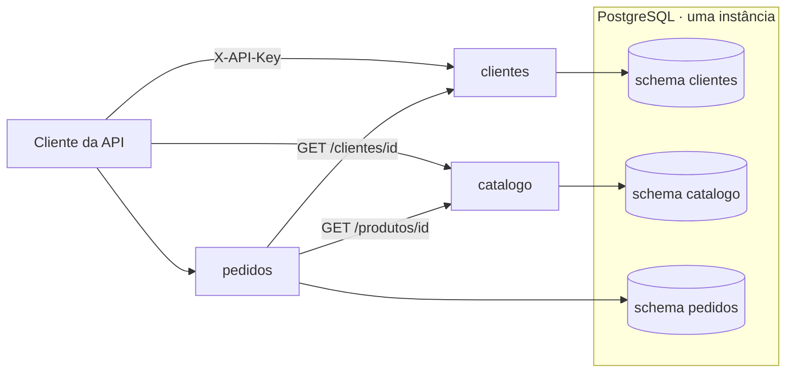
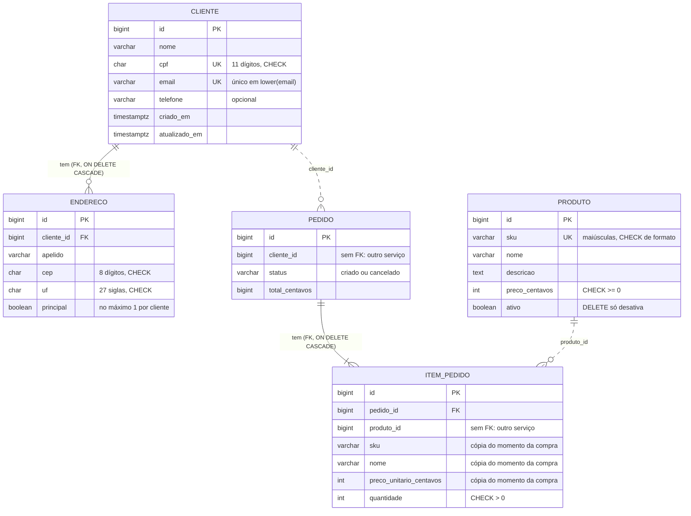
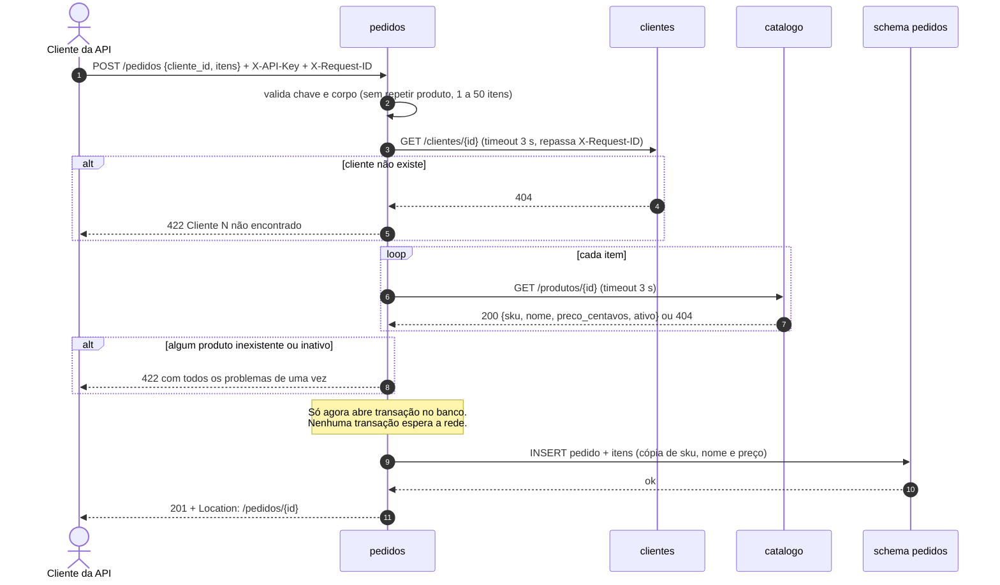
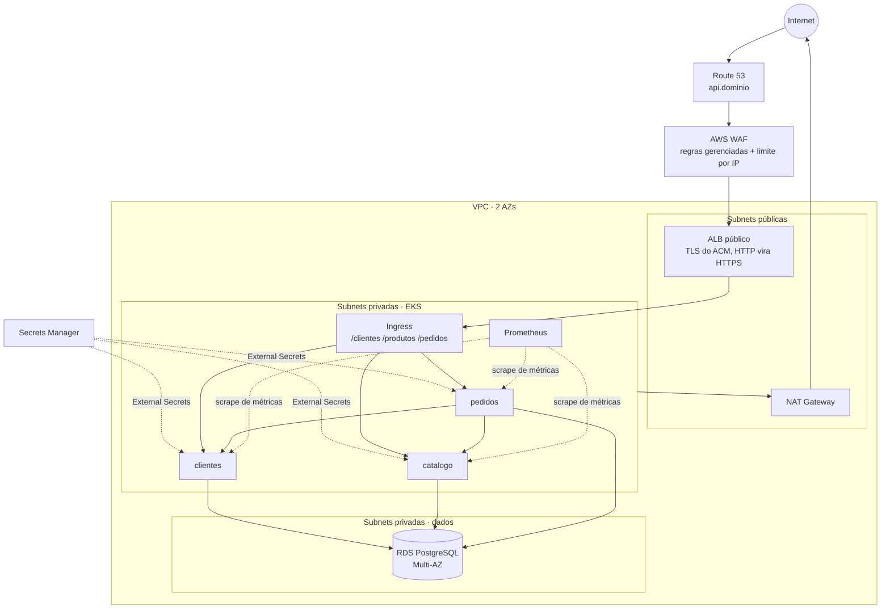

# Arquitetura da Vitrine

Visão técnica do sistema: o que existe hoje e como ele será exposto na AWS. As decisões que levaram a este desenho estão nas [ADRs](adr/).

## Visão geral

Mini e-commerce com três serviços HTTP independentes, cada um dono dos próprios dados.



| Serviço | Responsabilidade | Dados | Depende de |
| --- | --- | --- | --- |
| `clientes` | Cadastro de clientes e endereços | schema `clientes` | banco |
| `catalogo` | Produtos, preço e situação (ativo) | schema `catalogo` | banco |
| `pedidos` | Pedidos e itens, cancelamento | schema `pedidos` | banco, `clientes`, `catalogo` |

Regras que valem para os três:

- Um schema e um usuário de banco por serviço. Nenhuma consulta nem chave estrangeira atravessa schemas; um serviço só conhece o outro pela API ([ADR 0001](adr/0001-um-schema-por-dominio.md)).
- Configuração só por variável de ambiente. Nenhum endereço ou segredo no código.
- Sem estado local: qualquer réplica atende qualquer requisição.
- Mesma stack em todos: Python 3.12, FastAPI, SQLAlchemy 2, Alembic, PostgreSQL 17 ([ADR 0000](adr/0000-stack-e-forma-de-trabalho.md)).

## Modelo de dados

Cada bloco é um schema. As linhas tracejadas são referências por id **sem** chave estrangeira: a existência é conferida pela API no momento da criação do pedido.



Escolhas de modelagem:

- **Dinheiro em centavos inteiros.** Float não representa 0,10 com exatidão e soma erro.
- **Regras no banco além da API** (`CHECK`, `UNIQUE`, índice parcial do endereço principal). A API valida para dar mensagem clara; o banco garante mesmo quando alguém grava por fora ou duas requisições chegam juntas.
- **Produto com soft delete.** Pedidos antigos continuam apontando para um produto que existe.
- **Item do pedido guarda SKU, nome e preço.** Mudança no catálogo não reescreve a história de venda.
- **Pedido não tem `PUT` nem `DELETE`.** Depois de criado, só muda de status.

## Fluxo de criação de pedido



Quando um vizinho falha, o `pedidos` não devolve 500:

| Situação | Resposta |
| --- | --- |
| Vizinho fora do ar, conexão recusada | 503 + `Retry-After: 5` |
| Vizinho não responde dentro do timeout | 503 após `HTTP_TIMEOUT_SEGUNDOS` |
| Vizinho responde 5xx | 503 |
| Vizinho responde 401 ou outro 4xx inesperado | 502: é erro de configuração do `pedidos`, não do usuário |

Só falhas de conexão são repetidas automaticamente, porque nesse caso a requisição nem chegou ao outro lado. Cancelamento usa `SELECT ... FOR UPDATE` para dois cancelamentos simultâneos não passarem juntos.

## Contrato das APIs

| Tema | Regra |
| --- | --- |
| Autenticação | Header `X-API-Key`. Várias chaves aceitas ao mesmo tempo, para rodízio sem parada. Sem chave ou errada: 401 |
| Erros | `{"detail": "..."}`. 404 não existe, 409 conflito (CPF, e-mail ou SKU repetido, pedido já cancelado), 422 dado inválido, 502/503 falha de dependência |
| Criação | 201 com header `Location` |
| Listagens | Paginadas com `limit` (máximo 100) e `offset`. Filtros pela chave natural: `?cpf=`, `?sku=`, `?cliente_id=`, `?status=`, `?ativo=` |
| Rastreio | `X-Request-ID` recebido (formato restrito) ou gerado, devolvido na resposta e repassado entre serviços |
| Documentação | OpenAPI gerado do código em `/docs` de cada serviço |

## Operação

| Item | Como funciona |
| --- | --- |
| `/health` | Liveness. Não consulta o banco, para queda do banco não virar reinício em loop |
| `/ready` | Readiness. `SELECT 1` no banco; 503 tira a réplica do balanceamento. O do `pedidos` não consulta os vizinhos, para não cair em cascata |
| `/metrics` | Prometheus: `http_requests_total`, `http_request_duration_seconds` (rótulo pelo modelo da rota, não pelo id) e, no `pedidos`, `integracao_duracao_segundos` por vizinho e resultado |
| Logs | JSON, uma linha por evento, com `request_id`. Acesso a rotas de infraestrutura só em `DEBUG` |
| Banco | `bootstrap.sql` cria usuários e schemas (como administrador). Cada serviço aplica as próprias migrations antes de subir, como passo separado |
| Contêiner | Multi-stage, Python fixo, sem dependências de desenvolvimento, usuário sem root, uvicorn como PID 1 |

Ordem de subida, igual no `docker compose` e no Kubernetes:

```
banco saudável -> bootstrap -> migrations de cada serviço -> clientes, catalogo -> pedidos
```

## Exposição na internet (AWS)

Desenho alvo, a ser construído com Terraform e o deploy no EKS. A escolha de ALB + WAF em vez de API Gateway está na [ADR 0002](adr/0002-exposicao-com-alb-e-waf.md).



Camadas de proteção, de fora para dentro:

| Camada | O que barra |
| --- | --- |
| AWS WAF | Padrões de ataque conhecidos (injeção, entradas maliciosas), IPs de má reputação, excesso de requisições por IP |
| ALB | Só HTTPS, TLS 1.2+, só os prefixos publicados no `Ingress` |
| Security groups | Nós só aceitam o ALB; RDS só aceita os nós |
| NetworkPolicy | Dentro do cluster, cada serviço só recebe de quem precisa (`pedidos` → `clientes` e `catalogo`) |
| Aplicação | API key, validação de entrada, respostas sem detalhes internos |
| Banco | Usuário por serviço, sem acesso a outros schemas; sem endpoint público |
| Segredos | Secrets Manager, entregues ao pod pelo External Secrets; nunca no Git nem na imagem |

O que não é público: `/metrics` (só o Prometheus, de dentro do cluster), `/docs` e `/openapi.json`, `/health` e `/ready` (só as probes do Kubernetes) e o banco.

## Limites conhecidos

O desenho atual escolhe simplicidade em alguns pontos, de forma consciente:

- **Criação de pedido é síncrona.** Se `clientes` ou `catalogo` estiverem fora, não há pedido novo (503). Leitura e cancelamento continuam funcionando.
- **Uma chamada ao catálogo por item.** Com pedidos grandes, uma consulta em lote no catálogo reduziria a latência.
- **`POST /pedidos` não é idempotente.** Se o cliente repetir a requisição após um timeout, pode criar dois pedidos. A solução é uma chave de idempotência no header.
- **Uma instância de banco para os três serviços.** Barata e simples, mas uma consulta pesada de um serviço afeta os outros. Separar é trocar `POSTGRES_HOST`, porque nada atravessa schemas.
- **API key por ambiente, não por consumidor.** Não dá para saber nem revogar um chamador específico.
