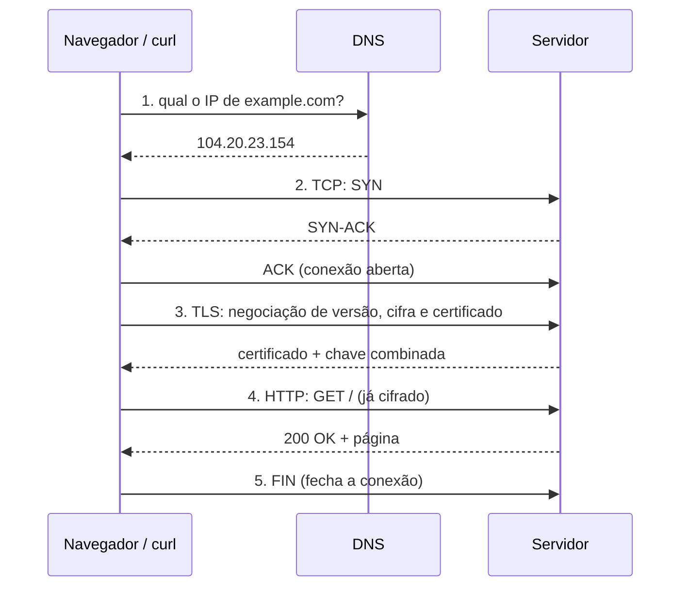

# Redes na prática

O que acontece entre digitar uma URL e ver a página, e como diagnosticar quando não acontece. Todas as saídas abaixo são reais, tiradas do [laboratório](../lab/README.md): a VM `vitrine-lab` (Ubuntu 26.04, IP `192.168.64.2`) servindo uma página com nginx, acessada pelo Mac (`192.168.64.1`).

## O caminho de uma requisição



### 1. DNS: nome vira IP

O programa pergunta ao resolvedor local, que pergunta adiante e guarda a resposta em cache pelo tempo do TTL.

```
$ dig +noall +answer +stats example.com A
example.com.    377   IN   A   172.66.147.243
example.com.    377   IN   A   104.20.23.154
;; Query time: 42 msec
;; SERVER: 127.0.0.53#53(127.0.0.53) (UDP)
```

- `377` é o TTL em segundos: por esse tempo, ninguém precisa perguntar de novo. É por isso que uma mudança de DNS "demora para propagar".
- `127.0.0.53` é o `systemd-resolved`, o resolvedor local do Ubuntu. Ele encaminha para o DNS da rede (`resolvectl dns` mostra qual).
- Dois IPs: o domínio está atrás de uma CDN; o cliente usa qualquer um.

Sem cache, a resposta é encontrada por delegação, de cima para baixo:

```
$ dig +trace +nodnssec example.com A
;; Received 864 bytes from 2001:7fe::53#53(i.root-servers.net)              <- raiz: "quem cuida de .com?"
;; Received 359 bytes from 2001:500:d937::30#53(l.gtld-servers.net)          <- .com: "quem cuida de example.com?"
;; Received 72 bytes from 2a06:98c1:50::ac40:23e4#53(elliott.ns.cloudflare.com) <- autoritativo: "o IP é este"
```

### 2. TCP: abrir a conexão

Capturado na VM enquanto o Mac acessava a página (`sudo tcpdump -i lima0 -nn "tcp port 80"`), horários removidos:

```
192.168.64.1.54139 > 192.168.64.2.80: Flags [SEW]  seq 880780875               <- SYN
192.168.64.2.80 > 192.168.64.1.54139: Flags [S.E]  ack 880780876               <- SYN-ACK
192.168.64.1.54139 > 192.168.64.2.80: Flags [.]    ack 1                       <- ACK: conexão aberta
192.168.64.1.54139 > 192.168.64.2.80: Flags [P.]   length 75: GET / HTTP/1.1   <- pedido
192.168.64.2.80 > 192.168.64.1.54139: Flags [.]    ack 76                      <- "recebi"
192.168.64.2.80 > 192.168.64.1.54139: Flags [P.]   length 555: HTTP/1.1 200 OK <- resposta
192.168.64.1.54139 > 192.168.64.2.80: Flags [.]    ack 556
192.168.64.1.54139 > 192.168.64.2.80: Flags [F.]                               <- FIN: cliente encerra
192.168.64.2.80 > 192.168.64.1.54139: Flags [F.]                               <- FIN: servidor encerra
192.168.64.1.54139 > 192.168.64.2.80: Flags [.]    ack 557
```

- **Three-way handshake**: SYN, SYN-ACK, ACK. Só depois disso algum dado passa.
- **Porta de origem** (`54139`) é sorteada pelo cliente; a de destino (`80`) é a do serviço.
- **`ack`** confirma até onde chegou: é assim que o TCP garante entrega e ordem.

### 3. TLS: cifrar a conversa

Com HTTPS, entre o TCP e o HTTP há a negociação TLS. O cliente confere o certificado (nome certo, emitido por uma autoridade confiável, dentro da validade) e os dois combinam uma chave.

```
$ curl -sv https://example.com -o /dev/null
* SSL connection using TLSv1.3 / TLS_AES_256_GCM_SHA384 / X25519MLKEM768 / id-ecPublicKey
* ALPN: server accepted h2
*   subject: CN=example.com
*   issuer: C=US; O=SSL Corporation; CN=Cloudflare TLS Issuing ECC CA 3
> GET / HTTP/2
< HTTP/2 200
```

- `TLSv1.3` com cifra `AES_256_GCM`. `X25519MLKEM768` é a troca de chaves híbrida, que já resiste a computadores quânticos.
- `subject` é para quem o certificado foi emitido; `issuer`, quem emitiu. O cliente só aceita se o nome bater e a cadeia chegar a uma autoridade em que ele confia.
- `ALPN: h2`: na própria negociação TLS, os dois combinam usar HTTP/2.

Quanto custa cada etapa:

```
$ curl -s -o /dev/null -w "dns=%{time_namelookup} tcp=%{time_connect} tls=%{time_appconnect} primeiro_byte=%{time_starttransfer} total=%{time_total}\n" https://example.com
dns=0.001170 tcp=0.019758 tls=0.042528 primeiro_byte=0.073340 total=0.073420
```

Os tempos são acumulados: o DNS veio do cache (1 ms), o TCP levou ~19 ms (uma ida e volta até a CDN), o TLS mais ~23 ms e o servidor respondeu ~31 ms depois. Em lentidão, é esta linha que diz onde está o tempo.

### 4. HTTP: o pedido e a resposta

```
$ curl -sv http://192.168.64.2/ -o /dev/null
* Connected to 192.168.64.2 (192.168.64.2) port 80
> GET / HTTP/1.1
> Host: 192.168.64.2
> User-Agent: curl/8.7.1
> Accept: */*
>
< HTTP/1.1 200 OK
< Server: nginx
< Content-Type: text/html
< Content-Length: 239
< Connection: keep-alive
```

- `>` é o que saiu, `<` o que voltou.
- `Host` diz qual site se quer: um mesmo IP pode servir vários.
- `Server: nginx` sem número de versão: o `server_tokens off` da role web.
- `keep-alive`: a conexão TCP pode ser reaproveitada para o próximo pedido, sem novo handshake.

## A rede do laboratório

```
$ ip -4 -br addr
lo      UNKNOWN  127.0.0.1/8
eth0    UP       192.168.5.15/24     <- rede interna do Lima, saída para a internet
lima0   UP       192.168.64.2/24     <- vzNAT: o IP que o Mac alcança

$ ip route
default via 192.168.64.1 dev lima0 proto dhcp src 192.168.64.2 metric 100
default via 192.168.5.2 dev eth0 proto dhcp src 192.168.5.15 metric 200
192.168.64.0/24 dev lima0 proto kernel scope link src 192.168.64.2 metric 100
```

Duas rotas padrão: vence a de menor `metric` (100, pela `lima0`). A rota `192.168.64.0/24 ... scope link` diz que essa rede é vizinha: o Mac está a um salto.

```
$ traceroute -n 192.168.64.1
 1  192.168.64.1  0.318 ms
```

Quem está ouvindo em cada porta, e qual processo:

```
$ sudo ss -tulpn
tcp  0.0.0.0:80          nginx
tcp  0.0.0.0:22          sshd
tcp  *:9100              prometheus-node
tcp  127.0.0.53%lo:53    systemd-resolve
```

`0.0.0.0` aceita conexão em qualquer interface; `127.0.0.53` só de dentro da máquina.

## Diagnóstico

### Porta ocupada

```
$ sudo python3 -m http.server 80
OSError: [Errno 98] Address already in use

$ sudo ss -ltnp "sport = :80"
0.0.0.0:80   users:(("nginx",pid=14665,fd=5),...)
```

Só um processo ouve numa porta por vez. O `ss` mostra quem é; `systemctl status` mostra se é um serviço.

### Recusado × timeout

Do Mac, com o nginx parado e o firewall ligado:

| Destino | O que acontece | `curl` | Tempo |
| --- | --- | --- | --- |
| Porta 80: liberada no ufw, ninguém ouvindo | O sistema responde com recusa (RST) | erro 7, *couldn't connect* | ~1 s |
| Porta 8080: bloqueada no ufw | O firewall descarta em silêncio | erro 28, *timeout* | 5 s (o limite) |

Recusa rápida quer dizer "cheguei na máquina, mas nada ouve ali": o problema é o serviço. Timeout quer dizer "nada respondeu": firewall, rota ou máquina fora do ar.

### Disco "cheio" com espaço sobrando

Um sistema de arquivos de teste com só 64 inodes:

```
$ while touch /mnt/teste-inode/f$i; do i=$((i+1)); done
touch: cannot touch '/mnt/teste-inode/f52': No space left on device

$ df -h /mnt/teste-inode
Filesystem  Size  Used Avail Use%
/dev/loop0   16M  152K   15M   2%

$ df -i /mnt/teste-inode
Filesystem  Inodes IUsed IFree IUse%
/dev/loop0      64    64     0  100%
```

"No space left on device" com 2% do espaço usado: acabaram os inodes, não os bytes. Acontece com milhões de arquivos pequenos (cache, sessões, filas). `df -h` não mostra; `df -i` mostra. O painel "Inodes usados" do Grafana do laboratório existe por isso.

## Comandos de bolso

| Pergunta | Comando |
| --- | --- |
| Quais são meus IPs? | `ip -br addr` |
| Por onde sai o tráfego? | `ip route` |
| Que IP tem esse nome? | `dig +short nome` |
| Quem responde por esse domínio? | `dig +trace nome` |
| Quem ouve em qual porta? | `sudo ss -tulpn` |
| A porta está aberta? | `nc -zv host porta` |
| Onde está a lentidão? | `curl -w` com `time_namelookup`, `time_connect`, `time_appconnect`, `time_starttransfer` |
| Qual o caminho até lá? | `traceroute -n host` |
| O que está passando no fio? | `sudo tcpdump -i <interface> -nn "tcp port 80"` |
| O firewall está deixando? | `sudo ufw status verbose` |
| Disco cheio? | `df -h` e `df -i` |
