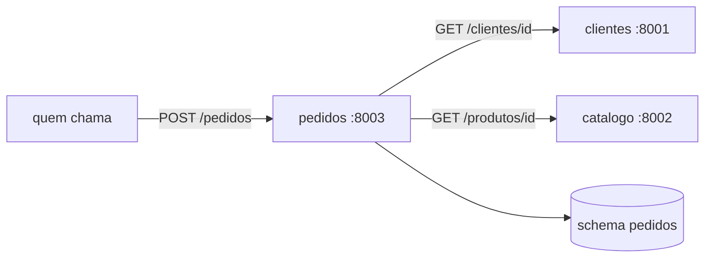

# pedidos

Pedidos de clientes. FastAPI + SQLAlchemy 2 + Alembic, em PostgreSQL no schema `pedidos`.

É o único serviço que chama outros: confere o cliente em `clientes` e os produtos em `catalogo` por HTTP antes de gravar. Não lê as tabelas deles: cada serviço só acessa o próprio schema.



## Rodando

Precisa do `clientes` e do `catalogo` no ar. Da raiz do repositório, com `make db-up` e `make db-bootstrap` já feitos, cada um num terminal:

```bash
make clientes-run
make catalogo-run
make pedidos-migrate && make pedidos-run   # http://localhost:8003/docs
make pedidos-test                          # não depende dos outros no ar
```

## Configuração

| Variável | Para quê |
| --- | --- |
| `CLIENTES_URL`, `CATALOGO_URL` | Onde estão os outros serviços. Local: `localhost`; no Kubernetes: o nome do Service |
| `CLIENTES_API_KEY`, `CATALOGO_API_KEY` | Chave que o pedidos apresenta a cada um |
| `HTTP_TIMEOUT_SEGUNDOS` | Tempo máximo por chamada (padrão 3) |
| `API_KEYS` | Chaves aceitas pelo próprio pedidos |

## Observabilidade

| Rota | Para quê |
| --- | --- |
| `/health` | Liveness: o processo está de pé. Não consulta o banco, para o Kubernetes não reiniciar o pod quando o problema é o banco |
| `/ready` | Readiness: `SELECT 1` no banco. 503 tira o pod do balanceamento até o banco voltar |
| `/metrics` | Formato Prometheus: `http_requests_total` e `http_request_duration_seconds` por método, rota e status |

As três ficam sem API key. Em produção, `/metrics` só é alcançável de dentro do cluster.

Logs em JSON, uma linha por evento, com `request_id`. O id vem do header `X-Request-ID` (ou é gerado) e volta na resposta. Os rótulos das métricas usam o modelo da rota (`/clientes/{cliente_id}`), nunca o id, para não criar uma série por recurso. `LOG_LEVEL` controla o nível; os acessos a `/health`, `/ready` e `/metrics` só aparecem em `DEBUG`.

O pedidos também mede cada chamada aos vizinhos (`integracao_duracao_segundos` por serviço e resultado: `ok`, `nao_encontrado`, `timeout`, `fora_do_ar`, `http_5xx`...) e repassa o `X-Request-ID` para eles. Uma requisição deixa o mesmo id no log dos três serviços.

## Endpoints

| Método | Rota | Sucesso | Erros |
| --- | --- | --- | --- |
| `GET` | `/pedidos?cliente_id=&status=&limit=20&offset=0` | 200 | 422 |
| `GET` | `/pedidos/{id}` | 200 | 404 |
| `POST` | `/pedidos` | 201 + `Location` | 422, 502, 503 |
| `POST` | `/pedidos/{id}/cancelar` | 200 | 404, 409 |

```json
POST /pedidos
{"cliente_id": 1, "itens": [{"produto_id": 3, "quantidade": 2}]}
```

Pedido não tem `PUT` nem `DELETE`: depois de criado, só muda de status. Histórico de venda não se reescreve.

## Comunicação com os outros serviços

| Situação | Resposta do pedidos |
| --- | --- |
| Cliente não existe | 422 `Cliente 7 não encontrado` |
| Produto não existe ou inativo | 422 com todos os produtos com problema de uma vez |
| Serviço fora do ar ou respondendo 5xx | 503 + `Retry-After: 5` |
| Serviço não responde dentro do timeout | 503 após `HTTP_TIMEOUT_SEGUNDOS` |
| Serviço responde 401 ou outro 4xx inesperado | 502 (erro de configuração nosso, não do usuário) |

Decisões:
- **Timeout em toda chamada.** Sem ele, um serviço lento prende as threads do pedidos até ele também parar.
- **Retry só de falha de conexão.** Nesse caso a requisição nem chegou ao outro lado, então repetir é seguro.
- **Nenhuma transação aberta durante a rede.** As chamadas HTTP vêm antes do primeiro acesso ao banco.
- **O item guarda SKU, nome e preço do momento da compra.** Mudar o preço no catálogo não altera pedido antigo.
- **Cancelamento com `SELECT ... FOR UPDATE`**, para dois cancelamentos simultâneos não passarem juntos.
- Um cliente HTTP por serviço, reaproveitado entre requisições (pool de conexões).

## Testes

Os serviços vizinhos são simulados com `httpx2.MockTransport`, que passa pelo cliente HTTP de verdade: dá para testar timeout, conexão recusada, 5xx e 401 sem nada no ar. Dois testes usam rede real (porta fechada e servidor que aceita a conexão e não responde) para provar que o timeout funciona.
